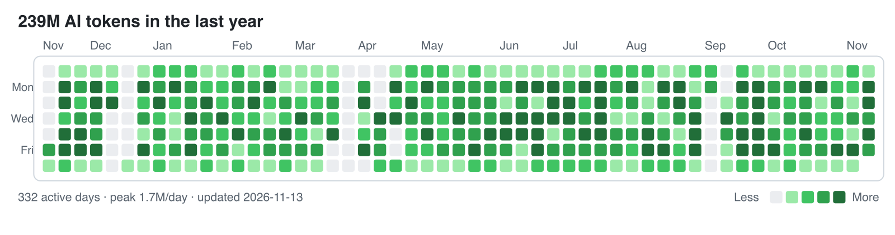

# dsh-token-heatmap

English | [中文](README.zh.md)

GitHub-style heatmap of your DeepSeek Harness token usage, written as a standalone SVG you can commit to your GitHub profile README.



Most usage plugins draw the heatmap inside DSH. This one writes the SVG and a JSON ledger to disk, so a scheduled job can publish them to GitHub — your profile keeps updating while the app is closed.

## Requirements

DSH 0.2.1-rc.2 or newer (tested on 0.2.1-rc.2) and Node 22.19+.

## Install

From the market or npm:

```sh
dsh plugin --profile web add @qpwlkq/dsh-token-heatmap
```

Without a registry, mount the checkout directly. Add this to `$DSH_HOME/profiles/<name>/cordis.patch.yml`:

```yaml
- insert:
    - id: token-heatmap
      name: '/absolute/path/to/token-heatmap/src/plugin.js'
```

Then run `/token-heatmap` in a conversation. It writes three files to the output directory (default `$DSH_HOME/token-heatmap`):

| File | Contents |
|---|---|
| `token-usage.json` | per-day token buckets, totals, window |
| `token-heatmap.svg` | light-theme heatmap |
| `token-heatmap-dark.svg` | dark-theme heatmap |

## What it counts

- **Buckets**: uncached input, output, cache read, cache write. The heatmap intensity uses their sum.
- **Source**: provider-reported usage on `assistant/message`, plus `assistant/chunk` usage blocks. A compaction call reports no usage and is not counted.
- **Dedupe**: an early usage chunk and the finalized message for the same `(turn, step)` count once; the later sample replaces the earlier one.
- **Days**: each sample is assigned to a calendar day in the configured IANA time zone.
- **Levels**: quantiles of your non-zero days (25/50/75 percent), so the grid stays readable at any usage scale.
- **Window**: 53 columns, ending today.

The command reads through `ctx.sessionQuery` when the profile composes it, so any persistence backend works. Without that seam it falls back to the durable JSONL logs under `$DSH_HOME/sessions`.

## CLI

```sh
node src/cli.js stats                        # totals only, writes nothing
node src/cli.js render --out docs            # scan sessions and write all three files
node src/cli.js render --from docs/token-usage.json --out docs   # re-render, no scan
```

Useful flags: `--home <dir>`, `--tz <zone>`, `--end YYYY-MM-DD`, `--weeks <n>`, `--title <text>`.

## Put it on your GitHub profile

1. Create the profile repository `<you>/<you>`.
2. Copy this repository into it (`src/`, `scripts/`, `package.json`, `cordis.patch.yml`).
3. Render:

   ```sh
   node src/cli.js render --out docs
   ```

4. Add the image to `README.md` at any position:

   ```html
   <picture>
     <source media="(prefers-color-scheme: dark)" srcset="./docs/token-heatmap-dark.svg">
     
   </picture>
   ```

5. Run `scripts/sync.sh` from cron or a launchd agent to render, commit, and push daily.

`sync.sh` only stages `docs/token-heatmap*.svg` and `docs/token-usage.json`. It never edits your README, so the block stays wherever you put it. GitHub caches README images through camo; add `?v=<date>` to the URL if you need an immediate refresh.

## Configuration

```yaml
- id: token-heatmap
  config:
    outputDir: /Users/you/token-heatmap
    timeZone: Asia/Shanghai
    weeks: 53
```

| Key | Default | Contract |
|---|---|---|
| `outputDir` | `$DSH_HOME/token-heatmap` | Directory the three files are written to. Created when missing. |
| `timeZone` | system zone | IANA name used to assign a sample to a calendar day. Invalid names fail the command. |
| `weeks` | `53` | Week columns, 4–104. |
| `autoUpdate` | `false` | Render five seconds after load and then on the interval below. Files whose bytes did not change are not rewritten. |
| `autoUpdateIntervalHours` | `6` | Hours between automatic renders, 1–168. |

## Privacy

The plugin reads only the event timestamp and the provider usage counters. It never reads prompt text, tool output, or attachments, and the ledger it writes contains dates, counts, and a time zone — no session ids, paths, or message content.

It makes no network requests and uses no credentials. The only write is `outputDir`.

## Limitations

- Only provider-reported usage is counted; estimated tokens are not.
- Cache reads usually dominate the total (often 90%+). The JSON keeps all four buckets if you want a different metric.
- One ledger describes one machine and one `$DSH_HOME`. Merging several machines is manual.
- Uninstalling the plugin leaves `outputDir` behind; remove it yourself.
- GitHub caches README images, so the published chart can lag behind the commit.

## Development

```sh
npm test                 # node:test, no dependencies
node scripts/demo.mjs    # regenerate the storefront screenshot source
```

## License

MIT
