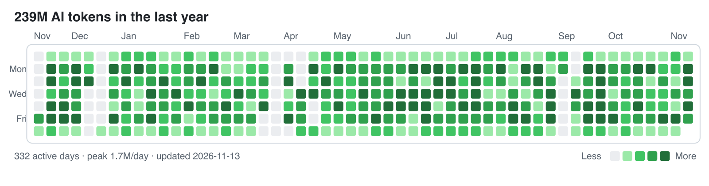

# dsh-token-heatmap

[English](README.md) | 中文

把 DeepSeek Harness 的 token 用量画成 GitHub 同款热力图，输出成可以直接提交到个人主页 README 的独立 SVG。



大多数用量插件把热力图画在 DSH 界面里；这个插件把 SVG 和一份 JSON 账本写到磁盘上，所以定时任务可以在应用关闭时也持续更新你的 GitHub 主页。

## 环境要求

dsh 0.2.1-rc.2 及以上（在 0.2.1-rc.2 上实测），Node 22.19 及以上。

## 安装

从市场或 npm 安装：

```sh
dsh plugin --profile web add @qpwlkq/dsh-token-heatmap
```

不走 registry 时，直接挂载本地目录。在 `$DSH_HOME/profiles/<name>/cordis.patch.yml` 里加：

```yaml
- insert:
    - id: token-heatmap
      name: '/absolute/path/to/token-heatmap/src/plugin.js'
```

然后在对话里输入 `/token-heatmap`。它会把三个文件写到输出目录（默认 `$DSH_HOME/token-heatmap`）：

| 文件 | 内容 |
|---|---|
| `token-usage.json` | 每天的 token 分桶、总量、时间窗口 |
| `token-heatmap.svg` | 亮色主题热力图 |
| `token-heatmap-dark.svg` | 暗色主题热力图 |

## 统计口径

- **分桶**：未缓存输入、输出、缓存读、缓存写；热力图深浅按四者之和。
- **来源**：`assistant/message` 上 provider 上报的 usage，以及 `assistant/chunk` 里的 usage 块。compaction 那次直连调用不报 usage，不计入。
- **去重**：同一 `(turn, step)` 先有 usage chunk、后有最终 message 时只算一次，后者替换前者。
- **归日**：按配置的 IANA 时区把每个样本落到日历日。
- **色阶**：非零日的 25/50/75 分位，四档；换机器、换用量水平都不会全灰。
- **窗口**：固定 53 列，最后一天是今天。

插件优先走 `ctx.sessionQuery`，所以换成 SQLite 等持久化后端也能读；该 seam 没有组合进来时，回退到 `$DSH_HOME/sessions` 下的 JSONL 日志。

## 命令行

```sh
node src/cli.js stats                        # 只打印统计，不写文件
node src/cli.js render --out docs            # 扫描 session 并写三个文件
node src/cli.js render --from docs/token-usage.json --out docs   # 不扫描，仅重渲染
```

常用参数：`--home <dir>`、`--tz <zone>`、`--end YYYY-MM-DD`、`--weeks <n>`、`--title <text>`。

## 接到 GitHub 个人主页

1. 建 profile 仓库 `<you>/<you>`。
2. 把本仓库复制进去（`src/`、`scripts/`、`package.json`、`cordis.patch.yml`）。
3. 生成：

   ```sh
   node src/cli.js render --out docs
   ```

4. 在 `README.md` 的任意位置插入：

   ```html
   <picture>
     <source media="(prefers-color-scheme: dark)" srcset="./docs/token-heatmap-dark.svg">
     
   </picture>
   ```

5. 用 cron 或 launchd 每天跑一次 `scripts/sync.sh`，自动渲染、提交、推送。

`sync.sh` 只 stage `docs/token-heatmap*.svg` 和 `docs/token-usage.json`，**永远不改你的 README**，所以插入的图放在哪里就一直在哪里。GitHub 会通过 camo 缓存 README 图片，需要立即刷新时给 URL 加 `?v=<日期>`。

## 配置

```yaml
- id: token-heatmap
  config:
    outputDir: /Users/you/token-heatmap
    timeZone: Asia/Shanghai
    weeks: 53
```

| 键 | 默认值 | 约定 |
|---|---|---|
| `outputDir` | `$DSH_HOME/token-heatmap` | 三个文件的输出目录，不存在时自动创建。 |
| `timeZone` | 系统时区 | 用来归日的 IANA 名称；非法名称会让命令失败。 |
| `weeks` | `53` | 周列数，4–104。 |

## 隐私

插件只读事件时间戳和 provider 上报的 usage 计数，不读 prompt、工具输出或附件。写出的账本只含日期、计数和时区，没有 session id、路径或消息内容。

不发起网络请求，不使用任何凭据；唯一的写入是 `outputDir`。

## 已知限制

- 只统计 provider 真实上报的 usage，估算值不计入。
- 缓存读通常占总量 90% 以上；JSON 里保留了四个分桶，想换口径可以自己算。
- 一份账本对应一台机器、一个 `$DSH_HOME`；多机合并需要手工做。
- 卸载插件不会删除 `outputDir`，需要自己清理。
- GitHub 缓存 README 图片，主页上的图可能落后于最新提交几分钟到几小时。

## 开发

```sh
npm test                 # node:test，零依赖
node scripts/demo.mjs    # 重新生成商店截图源文件
```

## 许可证

MIT
